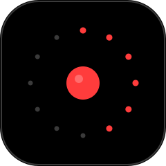
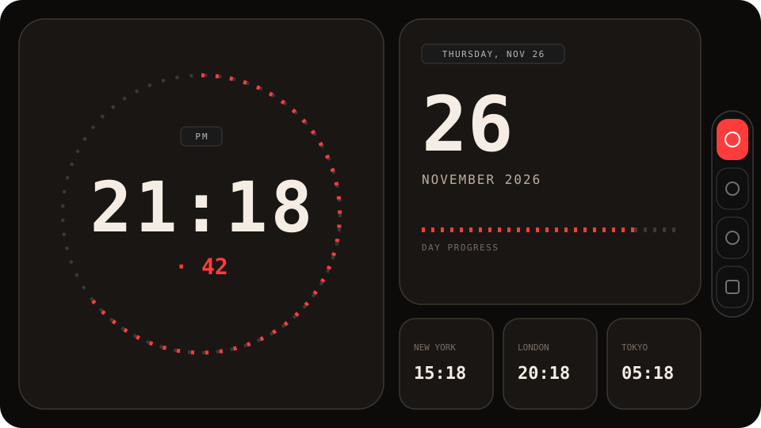
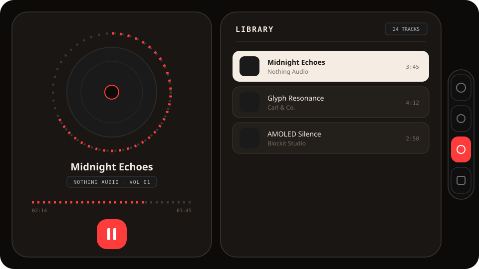

<p align="center">
  
</p>

<h1 align="center">Dot</h1>

<p align="center">
  <strong>AMOLED Clock Display &amp; Music Controller for Android Tablets &amp; Phones</strong><br/>
  <em>Blockit's warm glassmorphism meets Nothing OS's dot-matrix &amp; Glyph precision.</em>
</p>

<p align="center">
  
  
  
  
</p>

---

## Screenshots

<table>
  <tr>
    <td align="center"><strong>Clock Display (Tablet)</strong></td>
    <td align="center"><strong>Music Player &amp; Library (Tablet)</strong></td>
  </tr>
  <tr>
    <td></td>
    <td></td>
  </tr>
</table>

---

## Design Philosophy

**Dot** fuses two distinct design languages into one cohesive AMOLED experience:

| **Blockit** (Structure & Warmth) | **Nothing OS** (Precision & Light) |
|---|---|
| Warm dark brown surfaces (`#1A1613`) | Pure OLED black canvas (`#000000`) |
| Apple-style large corner radii (`28dp`–`32dp`) | Circuit-trace gradient borders |
| Glassmorphism cards with subtle sheen | 18px-spaced dot-grid card texture |
| Split-panel tablet layout & floating pill nav | **NDot** 5×7 dot-matrix clock digits |
| Warm cream typography | **Nothing Red** (`#FF3C3C`) & 60-dot **Glyph LED** rings |

---

## Features

### Clock Display
- **NDot Dot-Matrix Renderer:** Custom `Canvas`-drawn 5×7 circular dot-matrix digits with unlit LED glow.
- **Glyph Seconds Ring:** 60-dot circular LED ring around the clock that lights up second-by-second with a subtle breathing pulse.
- **Day Progress Strip:** 48-dot horizontal Glyph strip tracking your day.
- **World Clock Tiles:** Quick-glance tiles for New York, London, and Tokyo.

### Music Player & Controller
- **Spinning Vinyl Disc:** Album art inside a rotating disc wrapped by a 60-dot **Glyph Progress Ring**.
- **Media3 ExoPlayer Service:** Full background playback with system media notification, audio focus handling, and lock-screen controls.
- **Local Library Scanner:** Automatically scans device audio via `MediaStore`.
- **Glyph Scrubber:** 60-dot horizontal Glyph strip progress bar with play/pause, skip, shuffle, and repeat (off / all / one).

### Adaptive & AMOLED-First
- **Tablet (`≥600dp`):** Split-panel landscape layout with a floating pill sidebar on the right edge.
- **Phone:** Stacked card layout with a minimal Nothing-style bottom navigation bar (active red dot indicator).
- **3 Built-in Themes:** Switchable in `MainActivity.kt` (`AppTheme.FUSION`, `AppTheme.NOTHING`, `AppTheme.BLOCKIT`).
- **Android 14, 15 & 16:** Edge-to-edge transparent system bars (`minSdk = 34`, `targetSdk = 36`).

---

## Getting Started

### Prerequisites
- **Android Studio** Hedgehog (or later)
- **JDK 11+**
- Android device or emulator running **Android 14 (API 34)** or higher

### Build & Run
1. Clone the repository:
   ```bash
   git clone https://github.com/Prometheus-Open/Dot.git
   ```
2. Open the project folder in **Android Studio**.
3. Let Gradle sync and download dependencies.
4. Click **Run ▶** on your tablet, phone, or emulator.
5. Grant `READ_MEDIA_AUDIO` permission when prompted to load your local music library.

---

## Project Structure

```
Dot/
├── app/src/main/
│   ├── AndroidManifest.xml
│   └── java/com/amoled/clockmusic/
│       ├── MainActivity.kt                 # Entry point, edge-to-edge, permissions, theme
│       ├── media/
│       │   ├── MusicPlaybackService.kt     # Media3 foreground service
│       │   ├── MusicScanner.kt             # MediaStore local audio scanner
│       │   └── MusicViewModel.kt           # Playback state & MediaController
│       └── ui/
│           ├── theme/                      # Color.kt, Type.kt, Theme.kt (Fusion/Nothing/Blockit)
│           ├── components/
│           │   ├── BlockDigit.kt           # NDot 5×7 dot-matrix Canvas renderer
│           │   └── GlassCard.kt            # GlassCard, DotGridOverlay, GlyphRing, GlyphStrip
│           └── screens/
│               ├── ClockScreen.kt          # Clock display (tablet & phone)
│               ├── MusicScreen.kt          # Music player & library (tablet & phone)
│               └── MainScaffold.kt         # Adaptive navigation (floating pill / bottom bar)
├── docs/images/                            # Logo & UI mockups
├── CONTRIBUTING.md
└── LICENSE
```

---

## Roadmap

- [ ] In-app theme switcher (Fusion ↔ Nothing ↔ Blockit)
- [ ] Audio equalizer visualizer in NDot style
- [ ] Sleep timer with Glyph countdown ring
- [ ] Dynamic blurred album art background
- [ ] Home screen & Always-On Display (AOD) widgets

---

## License

Distributed under the MIT License. See [`LICENSE`](LICENSE) for more information.
